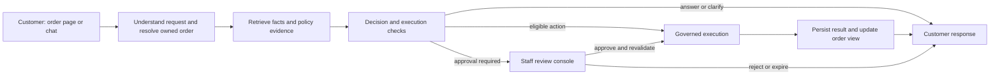

# Commerce Support Agent

[](https://github.com/bigfish-emily/commerce-support-agent/actions/workflows/ci.yml)

An **e-commerce order and after-sales assistant** with a customer interface and an asynchronous staff review console.

用户从自己的订单出发，用自然语言查询进度、了解政策或提出售后诉求；系统收集事实、核对政策并处理申请，需要授权审核的动作进入工作人员审核台。

Built with Python, FastAPI and LangGraph, with SQLite business state, optional Redis coordination and MCP integration adapters.

## How it works



- **Context-aware requests:** page-selected orders, compound intents and resumable tasks, alongside native order controls.
- **Review with evidence:** order facts, policy references and proposed actions travel with the case; staff can approve, reject and handle appeals.
- **Reliable execution:** schema and ownership checks, role/scope permissions, retry boundaries, durable idempotency records and recovery handling. Unknown write results are held for reconciliation.
- **Inspectable behavior:** recorded tool calls, redacted traces, business-state checks and reproducible evaluation artifacts.

This is a runnable sandbox using historical public orders and a versioned demo policy pack. Actions update local business records; they do not move money or contact a live OMS or logistics provider.

## Run locally

Requires Python 3.11+ and [uv](https://docs.astral.sh/uv/).

```bash
git clone https://github.com/bigfish-emily/commerce-support-agent.git
cd commerce-support-agent
uv sync --extra dev
uv run uvicorn app.main:app --host 127.0.0.1 --port 8000
```

| Entry | Use |
|---|---|
| [Demo](http://127.0.0.1:8000/demo) | Guided scenarios with resettable sandbox state |
| [Customer](http://127.0.0.1:8000/customer) | Order questions and after-sales requests |
| [Review](http://127.0.0.1:8000/review) | Evidence packets and approval decisions |

With no model key configured, the local demo uses deterministic fallback behavior. For live language understanding, set `OPENAI_API_KEY`, `OPENAI_BASE_URL` and `OPENAI_MODEL` in your environment or a local `.env`. See [configuration and usage](docs/USER_MANUAL.md). Do not commit credentials.

The repository includes 518 Olist-derived seed records. Full-data preparation and optional services are documented in the [implementation guide](docs/PROJECT_GUIDE.md). Redis is enabled with `RUNTIME_STORE_BACKEND=redis` and `REDIS_URL`; default operation uses the in-memory runtime backend.

Local identities and the review credential `local-review-demo` are demonstration defaults. Keep the service bound to localhost; an exposed deployment needs authenticated identities and deployment hardening. The internal `/chat` debugging endpoint is disabled by default.

## Evaluation you can inspect

The latest published experiment compares a workflow and a protected tool-calling loop on **50 authored order-page cases**, using `deepseek-flash`, shared business tools, policy and initial state.

| Measure | Workflow | Protected tool loop |
|---|---:|---:|
| Complete task success | 43/50 | 47/50 |
| Business-state checks passed | 50/50 | 48/50 |
| Mean model calls per request | 1.2 | 4.3 |
| Business-core P95, excluding human waiting | 2.13s | 5.51s |

Workflow fixes improved complete task success from **22/50 to 43/50** on this inspected regression set. The comparison exposes a tradeoff: fewer model calls and lower latency, with lower complete-task success than the tool loop. These are sandbox regression results, not production resolution rates or an unseen benchmark.

[Read the protocol, failures and row-level model-call evidence →](evaluation/results/matched_business_20260927/README.md)

## Explore the implementation

- [Architecture and flow diagrams](docs/ARCHITECTURE_DIAGRAMS.md)
- [Implementation and data sources](docs/PROJECT_GUIDE.md)
- [Recovery, timeout scheduling and cache protocol](docs/RECOVERY_PROTOCOL.md)
- [Evaluation design](docs/EVALUATION.md)

Policy retrieval uses lexical matching over Markdown policy/FAQ/rule documents. Support-corpus retrieval experiments are separate from the customer workflow. MCP adapters support integration experiments, including an optional policy-tool transport; default business tools run through local governed handlers.

## License

[MIT](LICENSE)
