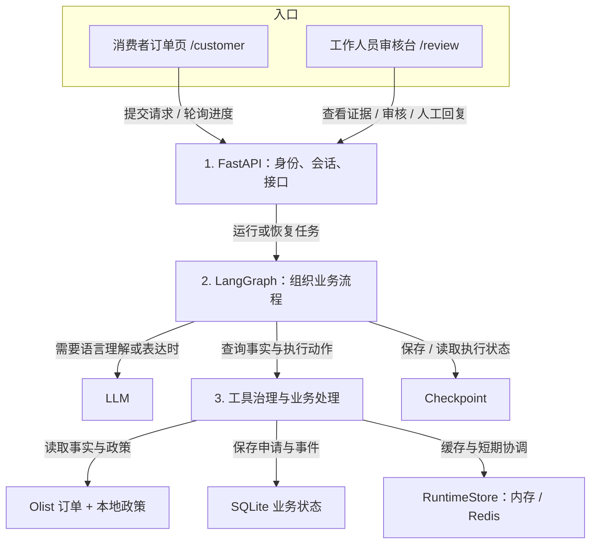
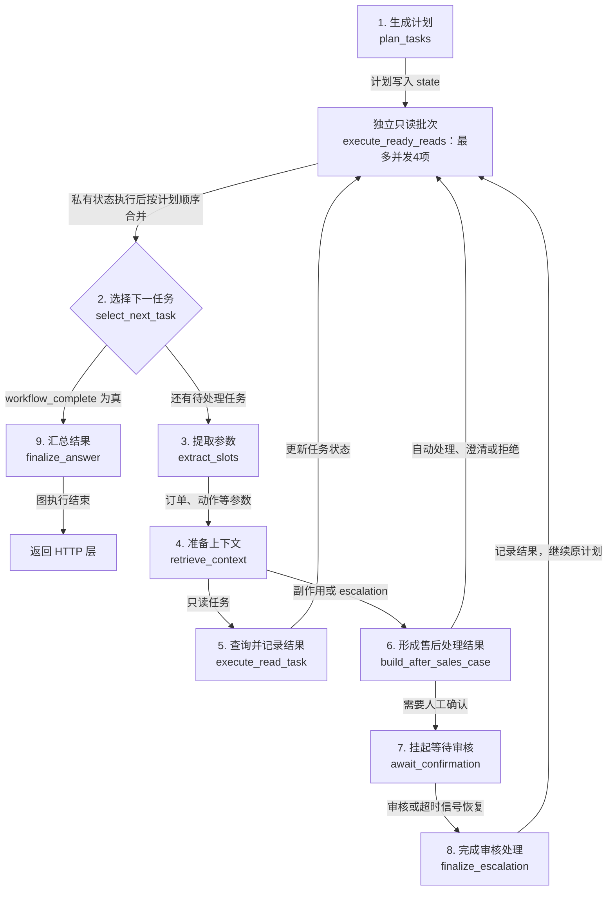
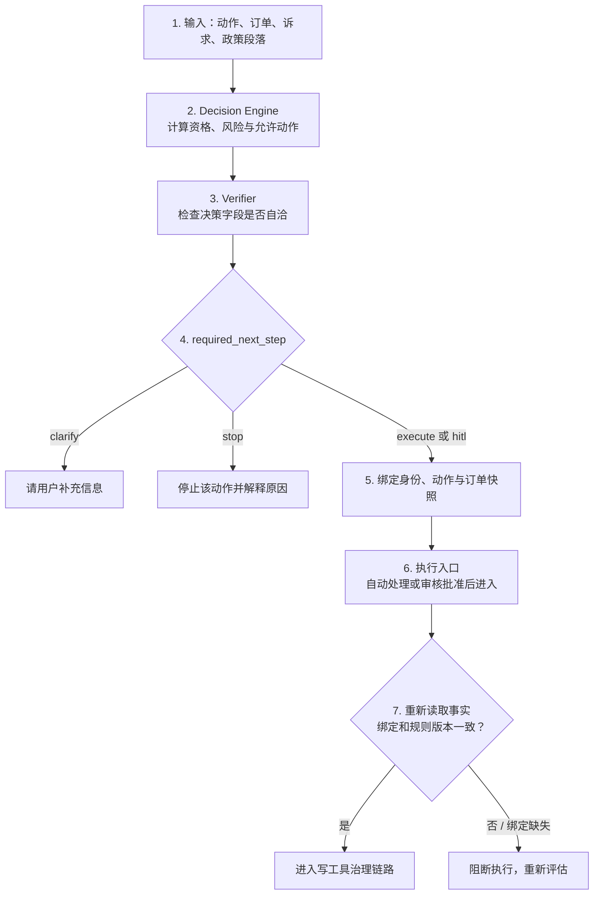
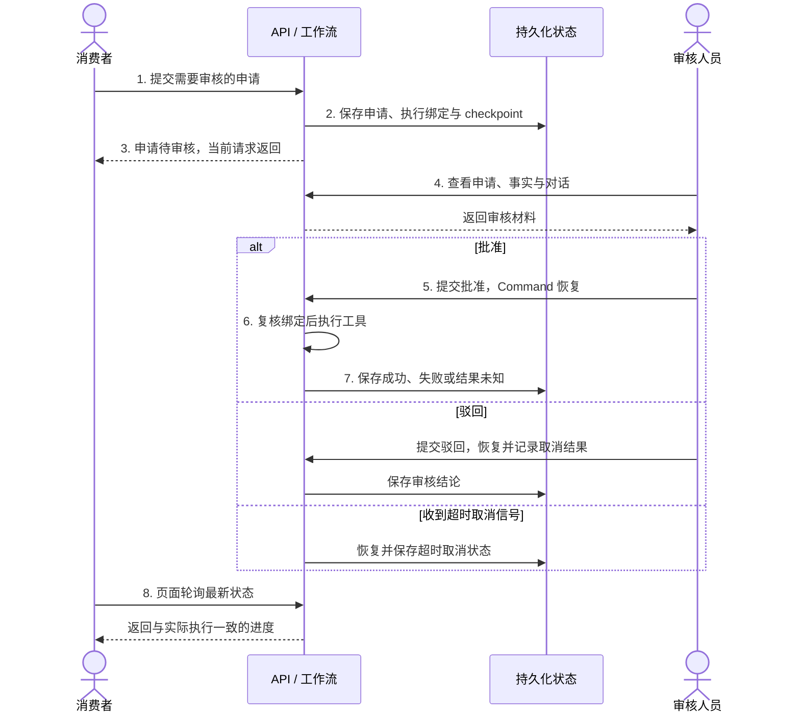
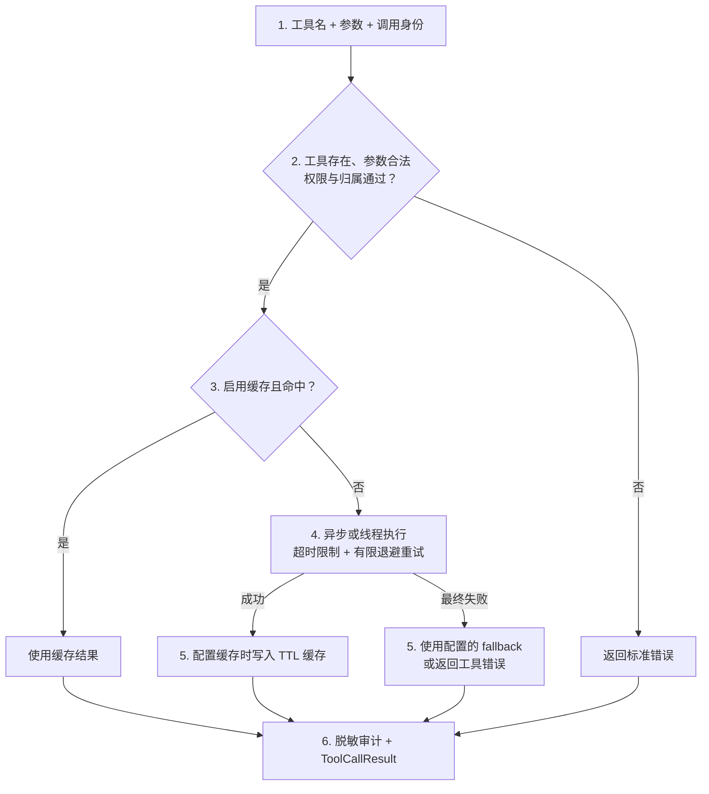
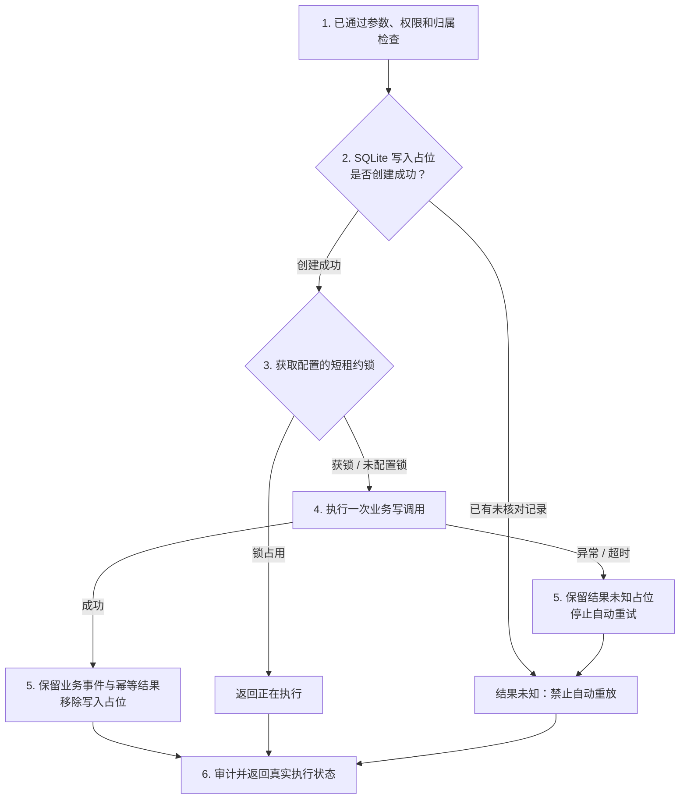
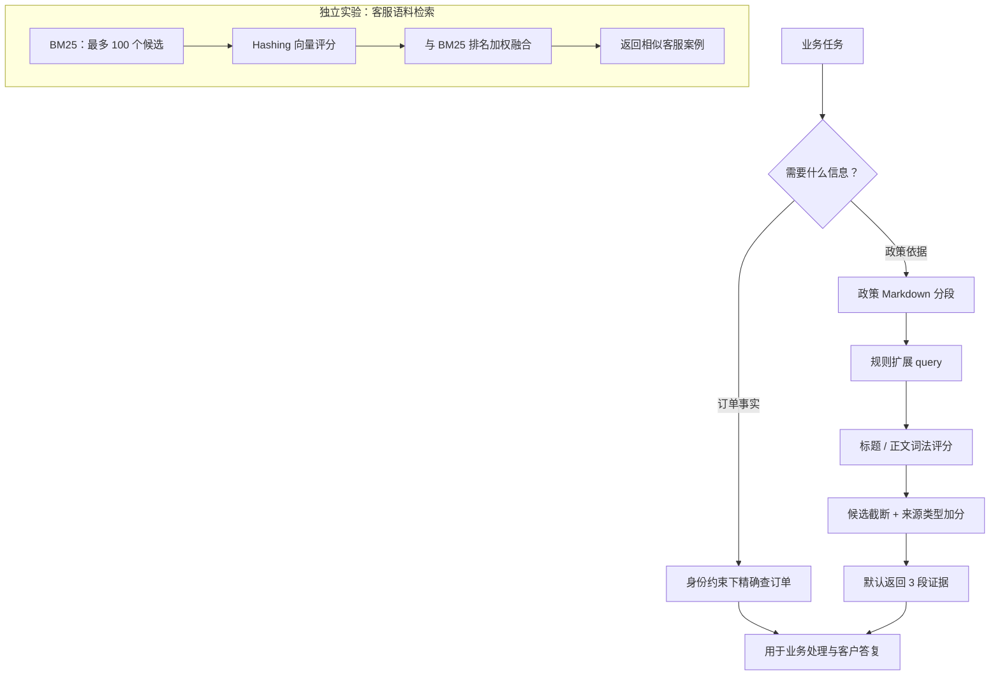
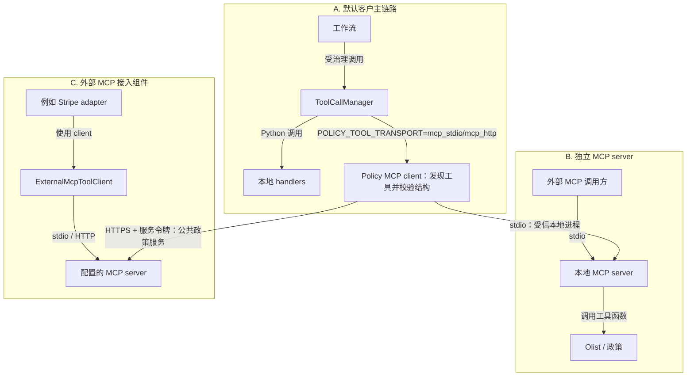
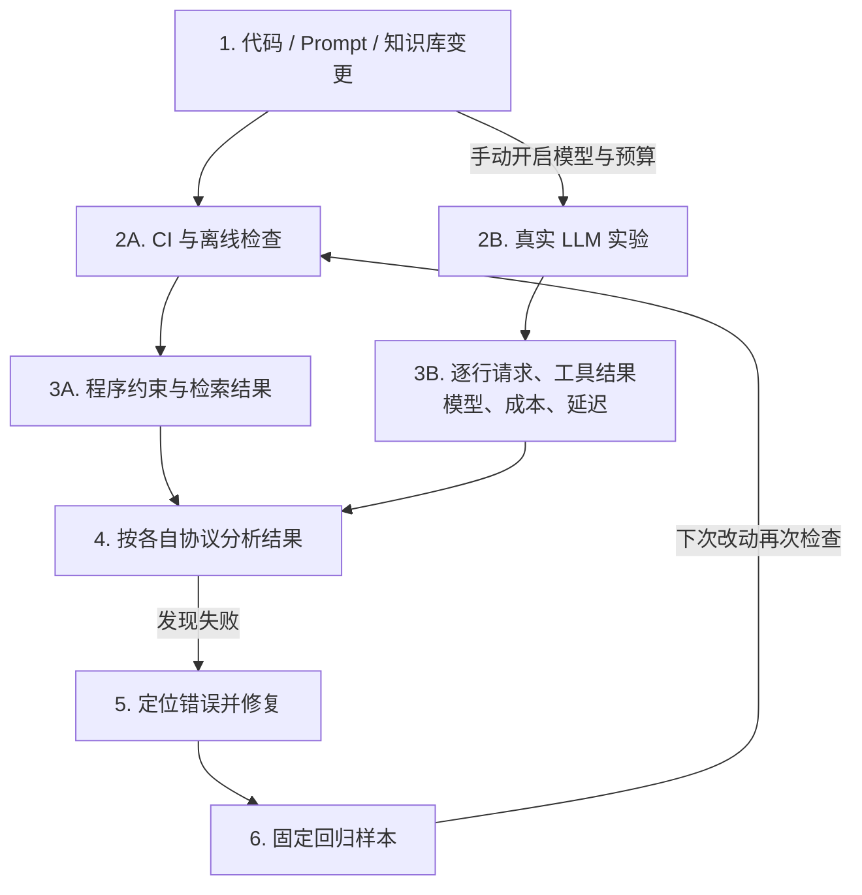

# 架构与链路图

核对日期：2026-09-26。阅读顺序：整体架构 → 请求主链路 → 决策与审核 → 工具执行 → 检索与接入 → 评测。跨存储恢复时序见 [恢复协议](RECOVERY_PROTOCOL.md)。

## 怎么读这些图

- 每张图只回答一个问题；框内保留简短职责，细节放在图后的步骤说明中。
- 流程图实线箭头表示调用或流程转移，箭头文字解释触发条件；菱形表示分支。架构图的数据访问箭头不意味着共用事务。
- 第 2 图与十个真实 LangGraph 节点对应；其他图展开节点内部或接口层行为，不能把所有框相加当作节点数。
- 第 4 图采用时序图，从上往下表示时间；实线是请求，虚线是答复。
- 每张图后依次列出流程说明、实现边界与源码入口。各图的 `.mmd` 文件与本文保持一致。

## 1. 整体架构：用户、工作人员和后端怎样协作

先看清谁使用系统，以及核心组件分别放在哪里。此图为逻辑分层，不代表每一层都是独立进程。

### 流程说明

1. 消费者从订单页面提交文本或按钮操作，工作人员通过审核台处理申请。两类入口共享后端，但使用不同身份与权限边界。

2. FastAPI 处理身份与会话；人工已接手、已有待审申请等情况可在 HTTP 层响应，不必重新规划任务。正常请求进入 LangGraph。

3. LangGraph 管理计划、任务状态和分支；需要语言能力时调用配置的 LLM。按钮操作及部分快速路径不需要模型规划。

4. 业务组件读取订单和政策，通过受治理工具写入本地业务状态。Checkpoint 保存图执行状态；SQLite case/event 保存业务结果，两者职责不同。

5. 调用结果沿接口返回页面，客户页轮询获取后续进度。日志与 trace 记录执行信息，为保持总图清晰未单独画出每一条记录线。

### 实现边界

数据库箭头表示调用关系。SQLite 是持久业务事实来源，审核命令和执行凭据用于跨 checkpoint 恢复；Redis 配置开启后提供共享缓存与协调，内存仅用于单进程演示。MCP 政策接入路径见第 8 图；客服语料实验见第 7 图。Jev 不在主链路。

源码：[HTTP 入口](../app/main.py)、[业务处理](../app/agent/actions.py)。 [独立图源](diagrams/overall_architecture.mmd)

## 2. 主链路：十个真实 LangGraph 节点

说明一个计划如何逐任务处理，以及审核后从哪里继续。框内中文是职责，英文是源码节点名。

### 流程说明

1. plan_tasks 把请求转为 state 中的任务计划。输入既可以是按钮传入的结构化动作，也可以是自由文本的规划结果。

2. select_next_task 检查任务及依赖状态，逐个选择待处理任务；workflow_complete 为真时进入 finalize_answer。这里没有并行多 Agent 调度。

3. extract_slots 准备订单、动作和其他参数，retrieve_context 获取当前任务所需上下文。

4. 只读任务进入 execute_read_task，保存查询结果后返回任务选择节点。回复片段先累积，不代表每完成一个只读节点就发一次 HTTP 答复。

5. 售后写意图进入 build_after_sales_case。Decision Engine、Verifier、自动执行等都在节点内部；拒绝、澄清或自动处理后返回任务选择节点。

6. 需要审核时进入 await_confirmation，interrupt 保存执行位置并结束当前 HTTP 等待。稍后恢复后，finalize_escalation 处理批准、驳回或超时，再回到原计划。

7. finalize_answer 汇总已记录结果，HTTP 层再进行客户表达与记录。失败或结果未知不能当作成功依赖继续执行。

### 实现边界

这是实际图拓扑。输入风控、HTTP 身份处理、ToolCallManager 和执行绑定校验没有被虚构为额外 LangGraph 节点。

源码：[图定义与三处条件路由](../app/agent/graph.py)。 [独立图源](diagrams/agent_execution_chain.mmd)

## 3. 业务决策：怎样从事实得到下一步动作

区分业务规则、决策自洽检查和执行前复核，解释为什么它们检查的时点不同。

### 流程说明

1. 输入包含候选动作、订单事实、用户诉求和政策检索段落。风险字段缺失时保留 null，例如 Olist 没提供的退款历史。

2. Decision Engine 使用代码规则输出 outcome、allowed_actions、risk、requires_human、证据、政策引用及规则版本；模型不直接授予业务写权限。

3. Verifier 检查决策内部矛盾，例如声明需要审核却关闭审核标志、允许写入却缺政策引用、拒绝结果仍带允许动作。该函数不等于完整政策语义证明器。

4. required_next_step 将请求分为 clarify、stop、execute、hitl。前两类更新任务结果；后两类为后续执行保存绑定。

5. 绑定记录批准对象的身份、会话、动作、决策与订单快照。自动执行直接进入执行入口；需要审核的请求先等待工作人员处理。

6. 执行前重新读取订单，并比较绑定及规则版本。参数被修改、订单发生变化或旧申请缺绑定时停止执行，不能沿用旧授权。

7. 校验通过后才进入写工具；工具仍会执行参数和权限校验。资格判定通过不代表工具调用一定成功。

### 实现边界

规则分值标记为 legacy_heuristic，不是模型概率。规则版本不等于全部政策文件版本。执行前检查尚不是远端 OMS 的原子条件更新。

源码：[决策与 Verifier](../app/after_sales/decision.py)、[执行绑定](../app/after_sales/execution_guard.py)。 [独立图源](diagrams/after_sales_decision.mmd)

## 4. 异步审核：用户离开页面后怎样继续

用时间顺序说明三个参与方的交接。向右实线为请求，虚线返回结果；图中的状态名为业务解释，不是代码枚举的逐项复制。

### 流程说明

1. 请求满足人工审核条件时，系统保存申请内容和执行绑定，并在 interrupt 位置持久化图状态。

2. 当前 HTTP 请求返回待审核结果，用户可以关闭页面。应用没有把连接一直占用到工作人员上线。

3. 审核人员通过已鉴权入口查看对话、订单事实、政策引用和拟执行动作。用户说 yes 不会替代工作人员审批。

4. 批准触发 Command 恢复；恢复后的节点先重新核对绑定，再执行写工具。驳回和超时信号也恢复流程，但走取消处理。

5. 执行状态区分成功、明确失败与结果未知。未知状态需要核对，不能显示为退款已完成。

6. 节点处理结束后继续原任务计划。客户页面轮询状态；当前链路不依赖 WebSocket 通知。

7. 驳回或超时后的申诉按新申请重新评估。它不撤销已经发生的业务事件，也不代表数据库回滚。

### 实现边界

超时信号由 FastAPI 后台扫描器产生：默认每15秒扫描 SQLite 的 expires_at，登记持久化审核命令，再恢复图。截止时间默认900秒，可配置。服务器停机后重启补扫，Redis 键过期不参与业务裁决。审核命令认领/续租、执行凭据重放与结果未知隔离组成恢复协议；缺失检查点时保留命令并退避重试，不盲目执行。

源码：[接口与审核恢复](../app/main.py)、[审核节点](../app/agent/actions.py)。 [独立图源](diagrams/hitl_resume_state.mmd)

## 5. 只读工具：校验、缓存、重试和返回

只展示查询类工具；写操作见下一图。箭头标签标明成功、失败和缓存分支。

### 流程说明

1. 调用方传入工具名、参数与 ToolCallContext。找不到工具时直接返回 unknown_tool，并记录审计。

2. Pydantic 校验参数，随后检查角色、Scope 和适用的订单归属。未通过则停止，不访问业务数据。

3. 只有配置 TTL 的非副作用工具才检查缓存；key 关联租户、主体、角色、scope、授权订单、工具、参数及政策版本。订单可变事实不缓存；政策版本变化使旧键失效。命中标记 cached。

4. 未命中时执行 handler，异步函数或线程执行按工具定义处理。失败时在配置次数内退避重试，而非无限循环。

5. 成功后按配置写缓存；最终失败时仅使用已配置的 fallback，否则返回错误。降级结果不能冒充查到了真实业务事实。

6. 缓存命中、校验失败和执行结果都会进入审计；调用方根据 ToolCallResult 的状态消费数据。

### 实现边界

只读重试策略不适用于副作用。身份与权限来自可信调用上下文才有意义；工具描述文本本身不构成授权。

源码：[ToolCallManager.call 与执行逻辑](../app/tool_call/framework.py)。 [独立图源](diagrams/tool_call_manager.mmd)

## 6. 写工具：防重复提交与结果未知隔离

单独展示最关键的写入路径；与上一图共享工具发现、参数和权限检查，避免在图里重复铺开。

### 流程说明

1. 写工具通过公共校验后跳过缓存。图按 SQLite-backed case service 展示；纯内存演示没有持久化写入占位。

2. write_attempts 以 tenant + order_id 的唯一 operation_key 插入 submitted。已有未核对记录返回 outcome_unknown；同订单换动作或改写话术都不能越过隔离。

3. RuntimeStore 获取同订单短租约锁并自动续租。锁占用返回 side_effect_in_progress，连接失败返回 runtime_unavailable；这两类尚未派发的请求释放 submitted 占位。执行开始后的异常则保留隔离记录。

4. 获锁后调用业务 handler。写调用异常或超时进入未知状态，不使用自动重试或成功型 fallback。执行结束用 token 校验释放锁。

5. 成功时业务 case store 保存事件、投影和幂等结果，移除 write_attempts 临时占位。重复成功请求的去重由业务持久化记录承担。

6. 崩溃会留下 submitted；异常会留下 outcome_unknown。后续请求无法静默重放，需经内部核对接口提供证据后解除隔离。

7. 上层按返回状态更新任务与客户进度。工具请求失败与业务操作未发生并不等价，因此不能只凭超时回复“退款失败，请再试一次”。

### 实现边界

订单写锁按 tenant + order_id 建立，并每 TTL/3 校验 token 续租。锁丢失时保留持久订单写占位，阻断新写入并要求核对。SQLite 占位无自动过期，保护共享数据库的执行器；远端请求仍需下游幂等键/条件更新与状态对账，尚无接入真实支付的 fencing 支持。

源码：[写调用治理](../app/tool_call/framework.py)、[write_attempts](../app/tool_call/write_journal.py)。 [独立图源](diagrams/write_execution.mmd)

## 7. 检索：订单事实、政策证据和相似对话各查什么

主业务只画两类信息读取；独立客服语料实验放在独立分组，避免误认为它给当前退款提供授权。

### 流程说明

1. 订单、支付金额等结构化事实通过身份约束下的工具查询。它们不通过相似度检索猜测。

2. 政策文件按二级标题分段，保存来源、标题和正文。query 使用规则词表扩展，再计算标题与正文 token overlap。

3. 默认 k=3 时先选最多 12 个候选，再按来源类型等规则加分，返回前三段。这个 rerank 是规则排序，不是 cross-encoder。

4. 命中段落用于客户解释和决策的政策引用。检索分数高不自动证明段落适用于该订单的全部条件。

5. 独立客服语料实验先用 BM25 取最多 100 个候选，再进行 Hashing 向量评分。融合分别使用最多 40 个排名项，公式为 0.2/(20+BM25排名) + 2.0/(20+向量排名)。

6. Hashing 向量可存 LocalVectorStore 或 Qdrant；切换后端没有改变其特征编码方式。相似案例的 intent@k 衡量意图标签命中，不能命名为政策命中率。

### 实现边界

主政策路径未使用训练型 embedding。图中实验分组与客户政策处理没有调用箭头；未使用 Jev、Neo4j 或 LlamaIndex 执行这里的检索。

源码：[政策检索](../app/olist/knowledge.py)、[融合检索](../app/retrieval/hybrid.py)、[向量实现](../app/retrieval/vector_store.py)。 [独立图源](diagrams/rag_paths.mmd)

## 8. MCP：与主调用路径分开看

主工作流的政策工具可以配置走本地或 MCP。只有政策检索接入这条外部传输路径；订单写入继续使用本地受治理服务。

### 流程说明

1. 工作流始终先经过 ToolCallManager 的参数、scope 和主体检查。政策 handler 由部署配置选择 local、mcp_stdio 或 mcp_http。

2. B 路径允许独立 MCP 调用方连接本地 server，发现并调用其暴露的工具。它不会自动继承 A 路径的全部治理逻辑。

3. 配置 MCP 政策后，client initialize、list_tools、检查 search_policy_knowledge 契约、call_tool，再验证结构化政策结果。stdio 子进程链路有实际集成测试；远程 HTTP 需要部署者提供 HTTPS 地址及服务凭据。Stripe adapter 仍是独立集成组件。

4. Schema、scope、risk 等描述帮助建立工具契约。连接认证、身份传递、服务端授权和业务幂等仍需要在具体接入路径落实。

5. 接真实 OMS 时，必须明确使用哪个路径、谁提供可信身份、谁执行最终授权，以及下游返回什么业务收据。不能仅根据存在 adapter 就宣称已跑通真实退款。

### 实现边界

默认 local 不额外启动进程。MCP 接入范围为公共沙箱政策，不传消费者敏感数据；远程服务必须验证服务令牌。独立 stdio server 不应直接作为无鉴权公网服务，订单和支付接入需要另外实现主体授权契约。

源码：[MCP server](../app/mcp_server.py)、[默认工具治理](../app/tool_call/framework.py)。 [独立图源](diagrams/mcp_enterprise_boundary.mmd)

## 9. 评测：从改动到失败归因

区分 CI 自动执行的检查与单独启动的真实模型实验。回归样本由失败分析形成，不暗示自动训练或自动发布。

### 流程说明

1. 代码、Prompt 或知识库变化后，先运行与改动相关的检查。无需为文档修改重复启动昂贵的全量模型实验。

2. CI 的静态检查、单测与离线评测主要验证程序约束和可重复数据处理。当前外部 benchmark launcher 在 CI 中是 dry-run。

3. 真实模型实验单独配置模型与预算，保留逐条输入输出、工具结果、实际模型和 fallback 来源，再统计成功、错误、成本与延迟。

4. 指标按实验协议分别解释：检索命中不能代替完整任务成功；确定性回归不能代替模型推理能力；外部 tau 环境不能代替产品 HTTP 主链路。

5. 失败分析定位是理解、参数、政策检索、授权、工具执行还是状态回写出错，再修改相应组件。

6. 失败案例固定为回归。已经看过并修复的样本标记为回归集，不继续当成独立未见测试集。

7. 历史 7/24 与 22/24 保留探索性口径。工具面和判分规则差异未消除前，不将其作为某个组件因果提升；新的公平实验结果需要单独落盘。

### 实现边界

当前没有根据评测自动训练模型或自动放量发布。图表示工程反馈流程，不声称已有线上用户满意度或人工节省数据。

源码：[CI 配置](../.github/workflows/ci.yml)、[评测协议](EVALUATION.md)。 [独立图源](diagrams/evaluation_flywheel.mmd)

## 继续阅读

[项目完整说明](PROJECT_GUIDE.md) 解释业务定位、数据来源和技术取舍；[使用手册](USER_MANUAL.md) 给出实际入口；[执行完整性](EXECUTION_INTEGRITY.md) 说明绑定与未知结果的约束。

图中的“成功”指对应工具或沙箱业务终态；提交申请、审核通过、本地状态更新和真实款项到账是不同阶段。
