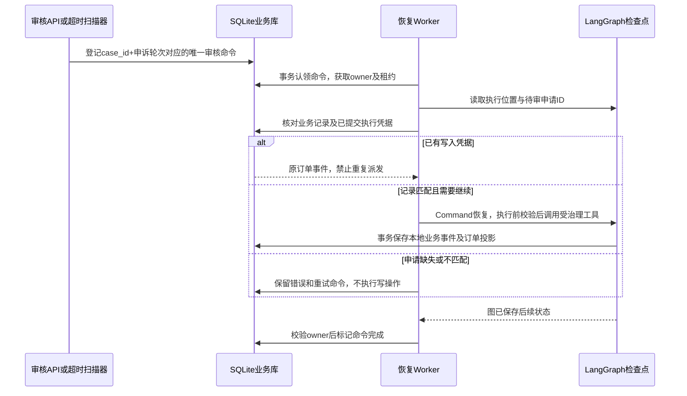

# 执行恢复与缓存协议

更新：2026-09-26。适用范围：消费者自助入口、人工审核 API，以及共享同一 SQLite 文件的执行器。

## 自动处理边界

订单查询、政策解释、澄清与明确的不符合条件答复自动完成。低风险且符合业务授权的动作可自动执行；需要人工授权、关键事实不足或出现争议时形成审核申请。人工只处理需要介入的申请，客户的 yes 不构成工作人员授权。

“人工占少数”是产品目标，需要按代表性用户流量测量；不能用刻意增加风险案例的回归集推算线上自动化率。

## 谁保存什么

| 存储 | 权威内容 | 故障后的处理 |
|---|---|---|
| SQLite case store | 申请、订单事件、投影、审核命令、未知写占位 | 以已提交记录为准，成功写的事件和投影同事务 |
| LangGraph checkpoint | 计划、已完成任务、执行位置、待审草稿 | 恢复前核对业务记录；已提交写读取凭据 |
| RuntimeStore | 限流、只读缓存、短租约、待审临时索引 | 不作为审核截止时间或执行成功的证据 |

1. 决定先落库再恢复图。同一个 case 的同一申诉轮次只接受一条命令，防止批准/驳回重复提交。
2. 命令租约120秒，每30秒续租。owner 条件更新防止旧 worker 覆盖新 worker 的命令状态。
3. 命令绑定 case_id；旧申请的重放不能批准同会话下一份申请。
4. 业务写成功但检查点未保存时，原绑定对应的订单事件作为完成凭据，恢复时不再调用写工具。
5. 检查点引用不存在或已失效的申请时停止写入。业务记录存在、检查点缺失时保留命令和错误，等待恢复；不会凭空拼造批准状态。
6. 命令失败采用有限间隔指数退避，最长256秒；记录不自动丢弃。后台每15秒扫描一次，可用 REVIEW_SCAN_SECONDS 调整。

## 锁过期与结果未知

Redis 使用 SET NX EX 获取订单级锁，token 匹配后释放/续租。TTL 按工具超时计算，TTL/3 续租。续租失败不会证明外部调用已停止，结果会隔离为 outcome_unknown。

SQLite 的订单级写占位没有 TTL，覆盖所有同订单写动作。它防止共享业务库的新执行器在 Redis 锁过期后派发第二次写。业务成功保留事件、释放占位；未派发的锁失败可释放；已派发结果未知必须核对证据后解锁。

没有向外部支付服务传递 fencing token；外部服务集成必须提供业务幂等键、状态查询与条件更新。此处的恢复保证限定在共享 SQLite 的沙箱写入。

## 审核超时

默认审核期限900秒，可配置 HITL_TIMEOUT_SECONDS。后台扫描 SQLite 的 expires_at 并登记取消命令，随后恢复图走超时分支。服务停机三天后，启动会补扫到期申请。取消的是待审申请，不会借此取消真实订单或自动退款。Redis 临时索引丢失不触发业务取消。

## 缓存策略

单机默认 memory；Docker Compose 配置 redis。两种实现遵循同一 RuntimeStore 接口，memory 不具备跨进程协调。Redis 配置故障时不会自动切回内存放行写操作。

缓存采用 cache-aside，缓存 key 包含 tenant、用户、角色、scope、订单授权集合、工具名、参数及政策内容版本。只缓存无错误的成功结果，回源成功后写入 TTL；缓存连接故障允许只读回源。

- 订单事实、我的订单、写动作草稿、评估和写入：不缓存，避免审批期间使用旧状态。
- 本地政策：300秒；Markdown 内容 hash 参与 key，更新后旧结果失效。
- 外部 MCP 政策：暂不缓存，直到接入可靠的远端版本契约。
- 类目聚合和客服样例：300秒；运营报告：120秒。
- 固定窗口限流：Lua 原子 INCR、TTL 和 EXPIRE，同时修复无 TTL 旧键。

## 验证范围

`tests/test_reliability_protocol.py` 验证真实 SQLite checkpoint 关闭后重开、到期命令补扫、旧审核命令隔离、已提交事件恢复、并发只读任务合并、主体缓存隔离、锁owner校验、释放失败以及实际 stdio MCP 政策调用。上述测试不调用付费模型；它们验证执行协议，不表示自然语言端到端成功率。

2026-09-26 验证记录：完整 pytest 179 passed；Ruff 通过；政策检索发布门禁通过。Windows 主机的 Docker 引擎未运行，本轮没有完成真实 Redis 服务联调，内存租约与 Redis 脚本替身测试不能代替该部署验证。最新运行时的真实 LLM 对照结果尚待复测，历史指标不随代码修改自动更新。
